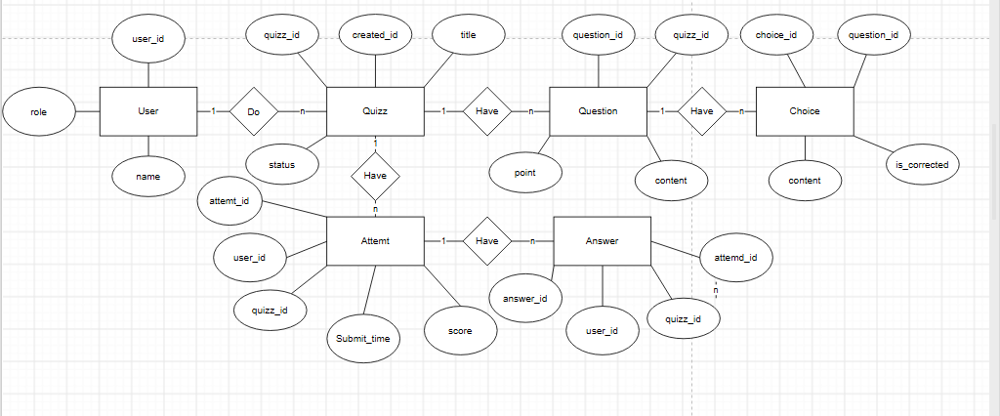

# README – Bài 1: Thiết kế API trắc nghiệm online

## 1. Giới thiệu
Bài tập lựa chọn domain **Trắc nghiệm online (Online Quiz System)** để thiết kế cơ sở dữ liệu và API theo yêu cầu đề bài.

## 2. Nội dung

### 2.1. Vẽ ERD
Thiết kế ERD gồm 6 thực thể chính:
- `USER`: Quản lý thông tin người dùng.
- `QUIZ`: Quản lý bài kiểm tra.
- `QUESTION`: Quản lý câu hỏi.
- `CHOICE`: Quản lý các phương án trả lời.
- `ATTEMPT`: Lưu lượt làm bài của người dùng.
- `ANSWER`: Lưu câu trả lời của người dùng.



### 2.2. Thiết kế Resource Set và URL List
Xây dựng 6 nhóm resource:
- Users
- Quizzes
- Questions
- Choices
- Attempts
- Answers

Thiết kế 20 API endpoints sử dụng các phương thức HTTP `GET`, `POST`, `PUT`, `PATCH`, `DELETE` để hỗ trợ các chức năng tạo, xem, cập nhật, xóa và nộp bài kiểm tra.

## Danh sách API Endpoints

| STT | Method | URL | Mô tả |
|---:|---|---|---|
| 1 | `POST` | `/users` | Đăng ký người dùng |
| 2 | `GET` | `/users` | Lấy danh sách người dùng |
| 3 | `GET` | `/users/{userId}` | Xem thông tin người dùng |
| 4 | `PATCH` | `/users/{userId}` | Cập nhật thông tin người dùng |
| 5 | `DELETE` | `/users/{userId}` | Xóa hoặc vô hiệu hóa tài khoản |
| 6 | `GET` | `/quizzes` | Lấy danh sách bài kiểm tra |
| 7 | `POST` | `/quizzes` | Tạo bài kiểm tra |
| 8 | `GET` | `/quizzes/{quizId}` | Xem chi tiết bài kiểm tra |
| 9 | `PATCH` | `/quizzes/{quizId}` | Cập nhật bài kiểm tra |
| 10 | `DELETE` | `/quizzes/{quizId}` | Xóa bài kiểm tra |
| 11 | `GET` | `/quizzes/{quizId}/questions` | Lấy danh sách câu hỏi |
| 12 | `POST` | `/quizzes/{quizId}/questions` | Thêm câu hỏi vào bài kiểm tra |
| 13 | `GET` | `/questions/{questionId}` | Xem chi tiết câu hỏi |
| 14 | `PATCH` | `/questions/{questionId}` | Cập nhật câu hỏi |
| 15 | `DELETE` | `/questions/{questionId}` | Xóa câu hỏi |
| 16 | `POST` | `/quizzes/{quizId}/attempts` | Bắt đầu làm bài kiểm tra |
| 17 | `GET` | `/attempts/{attemptId}` | Xem trạng thái lượt làm bài |
| 18 | `PUT` | `/attempts/{attemptId}/answers/{questionId}` | Lưu hoặc cập nhật câu trả lời |
| 19 | `POST` | `/attempts/{attemptId}/submit` | Nộp bài và chấm điểm |
| 20 | `GET` | `/users/{userId}/attempts` | Xem lịch sử làm bài của người dùng |


### 2.3. Viết JSON Schema
Xây dựng JSON Schema cho 3 resource chính:
- `User`: Thông tin người dùng, email và vai trò.
- `Quiz`: Thông tin bài kiểm tra, thời gian làm bài và trạng thái.
- `Question`: Nội dung câu hỏi, loại câu hỏi, điểm số và phương án trả lời.

Các schema quy định kiểu dữ liệu, trường bắt buộc, giá trị hợp lệ và giới hạn dữ liệu.


### 3. JSON Schema

Ba resource chính được định nghĩa bằng JSON Schema:

```text
schemas/
├── user.json
├── quizz.json
└── question.json
```
