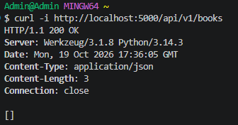
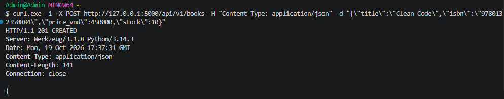
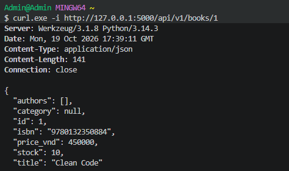
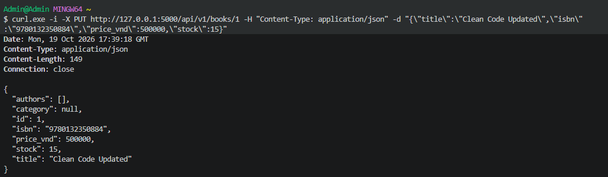
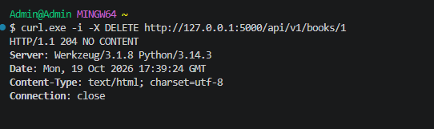

# Lab 1 - Bookstore API

## Mô tả

Xây dựng Bookstore API bằng Flask và SQLAlchemy.

Các thành phần chính:

- Data model: Book, Author, Category, User, Review.
- SQLite database.
- CRUD API cho Book.
- JSON Schema mô tả và hỗ trợ validate dữ liệu đầu vào.

## Cài đặt và chạy

Tạo môi trường ảo và cài đặt thư viện:

```bash
python -m venv venv
```

Trên **Windows PowerShell**:

```powershell
.\venv\Scripts\Activate.ps1
pip install flask flask-sqlalchemy jsonschema
python app.py
```
Server chạy tại:

```text
http://127.0.0.1:5000
```

## API Testing

> Các lệnh bên dưới dùng `curl.exe`, phù hợp với Windows PowerShell. Chạy server trước khi kiểm thử.

### Test 1 - GET /books

Kiểm tra lấy danh sách tất cả books.

```powershell
curl.exe -i http://127.0.0.1:5000/api/v1/books
```



### Test 2 - POST /books

Kiểm tra tạo một book mới.

```powershell
curl.exe -i -X POST http://127.0.0.1:5000/api/v1/books -H "Content-Type: application/json" --data "{\"title\":\"Clean Code\",\"isbn\":\"9780132350884\",\"price_vnd\":450000,\"stock\":10}"
```




---

### Test 3 - GET /books/{id}

Kiểm tra lấy thông tin book vừa tạo. Ví dụ sử dụng ID `1`.

```powershell
curl.exe -i http://127.0.0.1:5000/api/v1/books/1
```




---

### Test 4 - PUT /books/{id}

Kiểm tra cập nhật thông tin book có ID `1`.

```powershell
curl.exe -i -X PUT http://127.0.0.1:5000/api/v1/books/1 -H "Content-Type: application/json" --data "{\"title\":\"Clean Code Updated\",\"isbn\":\"9780132350884\",\"price_vnd\":500000,\"stock\":15}"
```


---

### Test 5 - DELETE /books/{id}

Kiểm tra xóa book có ID `1`.

```powershell
curl.exe -i -X DELETE http://127.0.0.1:5000/api/v1/books/1
```




