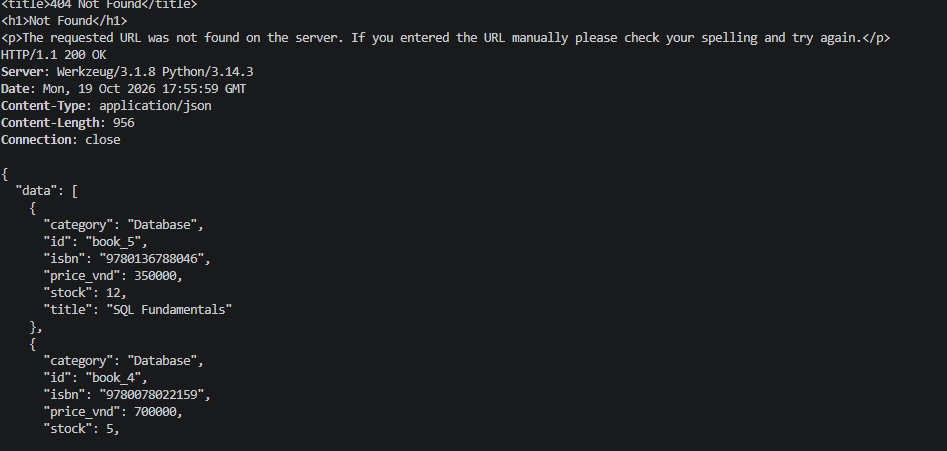
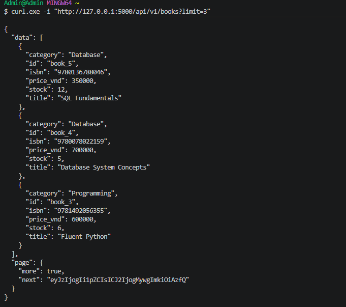
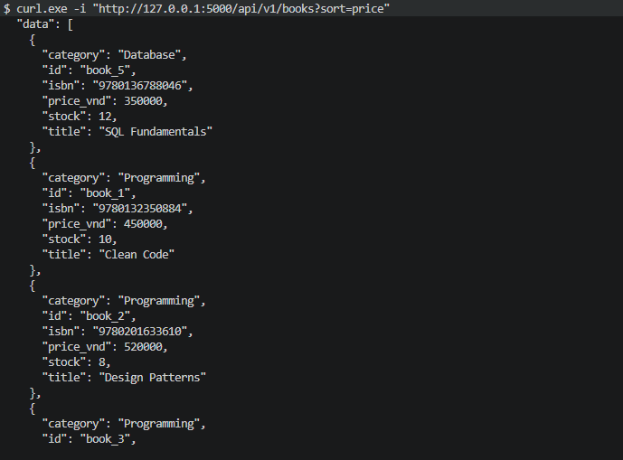
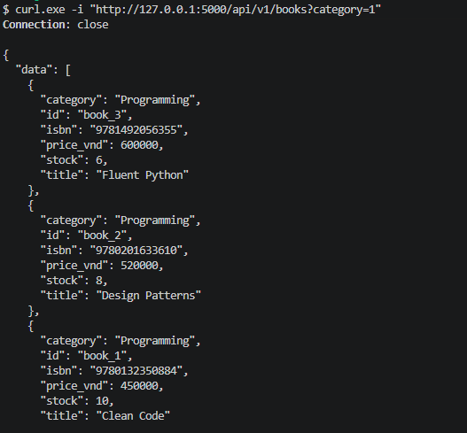
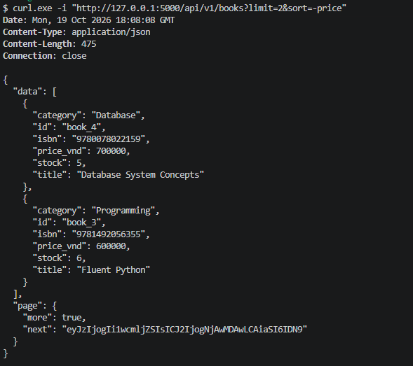
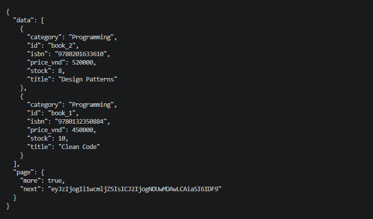
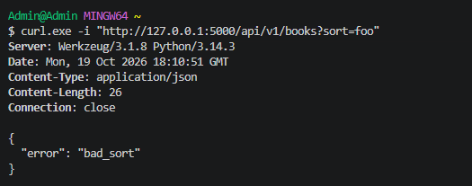

# Lab 2 - Filtering, Sorting and Cursor Pagination

## Mô tả

Mở rộng Bookstore API với:

- Filter theo `category`.
- Sort theo `id` hoặc `price`.
- Hỗ trợ sort tăng dần và giảm dần.
- Cursor pagination.
- Composite cursor sử dụng `(sort value, id)`.

## API Testing

### Test 1 - GET Books

Kiểm tra lấy danh sách books với mặc định `sort=-id`.

```powershell
curl.exe -i "http://127.0.0.1:5000/api/v1/books"
```

### Test 2 - Limit

Kiểm tra giới hạn số lượng books trả về.

```powershell
curl.exe -i "http://127.0.0.1:5000/api/v1/books?limit=3"
```


Kết quả trả về tối đa 3 books và cursor cho trang tiếp theo.

### Test 3 - Sort Price

Kiểm tra sắp xếp books theo giá tăng dần.

```powershell
curl.exe -i "http://127.0.0.1:5000/api/v1/books?sort=price"
```


### Test 4 - Filter Category

Kiểm tra filter books theo category.

```powershell
curl.exe -i "http://127.0.0.1:5000/api/v1/books?category=1"
```


### Test 5 - Cursor Pagination

Lấy trang đầu tiên với `limit=2` và sắp xếp theo giá giảm dần.

```powershell
curl.exe -i "http://127.0.0.1:5000/api/v1/books?limit=2&sort=-price"
```



Response trả về `next` cursor

"next": "eyJzIjogIi1wcmljZSIsICJ2IjogNjAwMDAwLCAiaSI6IDN9"

Sao chép giá trị `next` và truyền vào request tiếp theo:

```powershell
curl.exe -i "http://127.0.0.1:5000/api/v1/books?limit=2&sort=-price&cursor=eyJzIjogIi1wcmljZSIsICJ2IjogNjAwMDAwLCAiaSI6IDN9"
```



### Test 6 - Invalid Sort

Kiểm tra API từ chối sort key không được hỗ trợ.

```powershell
curl.exe -i "http://127.0.0.1:5000/api/v1/books?sort=foo"
```



